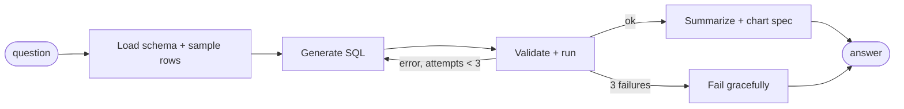

# Text-to-SQL Copilot

Ask questions about a database in plain English. A LangGraph agent writes the SQL, checks it for safety, runs it read-only, fixes its own errors, and returns a summary, the result table and an auto-picked chart.

## Agent graph



## Safety layers

1. **sqlglot parse**: exactly one statement, SELECT only, no INSERT, UPDATE, DELETE, DDL or PRAGMA.
2. **Row cap**: adds `LIMIT 200` or lowers a larger limit.
3. **Read-only connection**: SQLite opens with `mode=ro`, so the database rejects writes even if a check is bypassed.

## Self-correction

When a query fails (bad table name, syntax error, blocked statement), the error goes back to the LLM with the failed SQL. The agent retries up to 3 times.

## Run

```bash
# backend
cd backend
pip install -e ".[dev]"
python -m copilot.seed data/shop.db
export ANTHROPIC_API_KEY=...
uvicorn copilot.api:app --reload

# frontend
cd frontend
npm install
npm run dev     # http://localhost:5173
```

Or run both: `docker compose up --build`

## Tests

```bash
cd backend && pytest
```

Tests cover the SQL validator, the read-only connection, chart selection, and the self-correction loop (with a stub SQL writer, no API key needed).

## Stack

LangGraph, LangChain, sqlglot, SQLite, FastAPI, React, Vite, Recharts, Docker.
